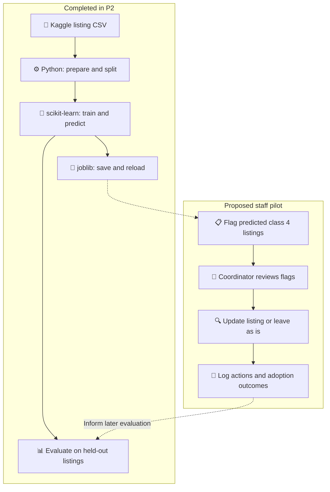
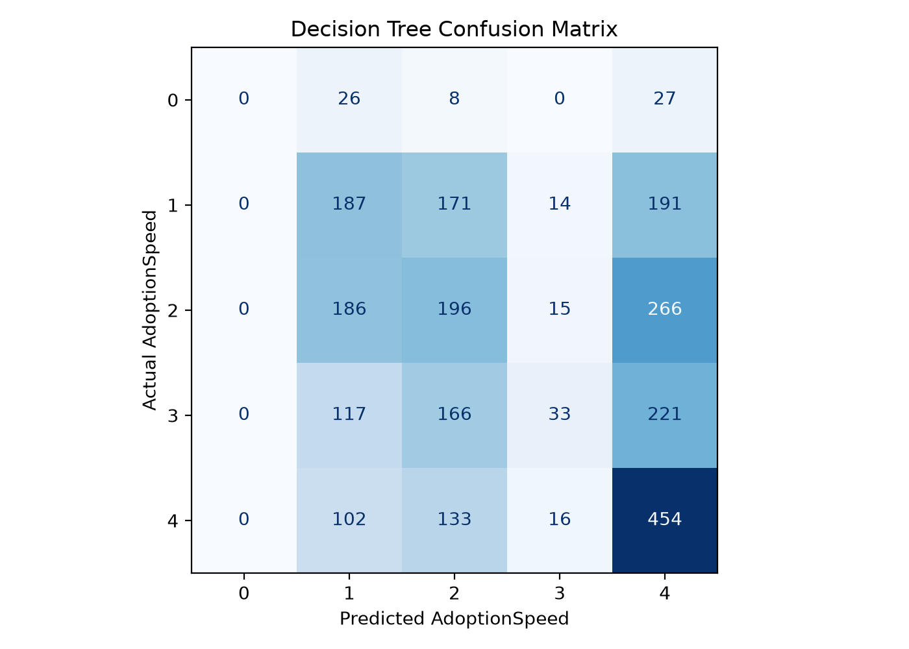

# PetFinder.my Adoption Prediction — P2 Report Draft

**Min Yang | MSBA 265 — Special Analytics Topics | University of the Pacific**

## 1. Executive Summary

This project examines whether basic information from pet adoption listings can help rescue staff identify listings that may remain unadopted for longer. I trained a Decision Tree using four features: pet type, age, adoption fee, and number of photos. On 2,529 test listings from rescuer groups held out of training, the tree achieved 34.40% accuracy, compared with 27.88% for a baseline that always predicted the most common training class.

The tree identified 454 of the 705 actual class 4 listings. If staff reviewed every listing predicted as class 4, they would review 1,159 listings in the test set, and 39.17% of those would belong to class 4. The tree also missed all 61 same-day adoptions. I recommend testing a small, staff-led review process with a fixed workload before using the model to prioritize listings in practice.

## 2. Business Context and Objective

Animal rescue staff have limited time to review adoption listings and decide which ones may need extra attention. This project examines whether four details available in the PetFinder.my dataset—pet type, age, adoption fee, and number of photos—can help predict adoption speed. The goal is to assess whether the model could help staff identify listings that may remain unadopted for longer and decide which ones to review first.

The intended user is a rescue coordinator who decides how to spend the team's review time. For that decision, two results matter: how many listings with a class 4 outcome the model identifies and how many total listings staff would need to review. I use the test set to estimate both quantities under a simple rule that flags every class 4 prediction.

## 3. Individual Project Ownership

In P1, I explored the distribution of `AdoptionSpeed` and examined how it varied by pet type, age, adoption fee, and photo count. I carried those four features into P2 so I could connect the model to the patterns I had already examined.

For P2, I prepared the training and test sets, implemented the majority-class baseline, trained the Decision Tree, and compared their results. I generated the confusion matrix and calculated how many class 4 listings the model found, missed, and incorrectly flagged. I also saved the fitted model and checked its prediction in a separate Python process.

## 4. Topic and Industry Context

PetFinder.my is a pet adoption platform in Malaysia. Its Kaggle competition provides historical listings with recorded adoption-speed categories, creating a dataset for studying how listing information relates to adoption outcomes (PetFinder.my, n.d., 2018).

The competition frames adoption speed as an ordered prediction problem. This project uses the same outcome to explore a practical question for rescue staff: whether a model can identify a manageable group of listings for closer review. For example, a coordinator could check whether a flagged listing is still active or needs updated information. Those actions are proposed uses of the model. Their effect on adoption outcomes would need to be evaluated separately.

## 5. Data and Preparation

I used the labeled `train.csv` from the PetFinder.my Adoption Prediction competition (PetFinder.my, 2018). The file contains 14,993 rows, and each row represents one listing. The target, `AdoptionSpeed`, contains five ordered classes from 0 through 4. Class 0 represents same-day adoption. Class 4 is the competition's longest outcome category, indicating that the pet was not adopted after 100 days.

| Field | Meaning | Role in P2 |
|---|---|---|
| `Type` | Pet type, recorded as a numeric code for dog or cat | Model feature |
| `Age` | Pet age in months | Model feature |
| `Fee` | Listed adoption fee in Malaysian ringgit | Model feature |
| `PhotoAmt` | Number of photos in the listing | Model feature |
| `AdoptionSpeed` | Recorded adoption-speed class | Prediction target |
| `RescuerID` | Identifier for the rescuer associated with the listing | Grouping field for the train-test split |

I checked the four model features for missing values in both sets. All four had zero missing values, so the current model uses those fields directly without imputation. `Type` is a binary category. I kept its original coding because a single tree split can distinguish the two pet types. `RescuerID` was used only to assign listings to the training or test set.

## 6. Method and Implementation

I used `GroupShuffleSplit` with `RescuerID` as the grouping field and `random_state=42`. About 20% of rescuer groups were held out for testing. Because rescuers can have different numbers of listings, the resulting split contained 12,464 training listings and 2,529 test listings. I verified that zero rescuer IDs appeared in both sets. This design measures performance on listings from rescuers the model had not seen during training.

The baseline predicts whichever class appears most often in the training set. I compared it with a Decision Tree limited to a maximum depth of 4. I chose a shallow tree to keep the first model simple and make its decision rules easier to inspect. Both methods used the same test listings for evaluation. The implementation is in `P2/p2_baseline.py`.



**Figure 1.** Data-to-action pipeline. The completed work covers data preparation, model training, evaluation, and model reload. The proposed pilot would use predictions to create a review list, record what staff decide, and use those records to evaluate whether the review process is helpful.

## 7. Evaluation and Findings

I evaluated the Decision Tree and the majority-class baseline on the same 2,529 test listings. The baseline predicted class 4 for every listing because it was the most common class in the training set.

I used three metrics. Accuracy measures the share of exact matches. Macro F1 averages the F1 score across all five classes, giving each class equal weight regardless of how many listings it contains. Quadratic weighted kappa accounts for agreement expected by chance and gives a larger penalty to predictions that are farther from the actual class.

**Table 1.** Model performance on the held-out test set.

| Metric | Majority-class baseline | Decision Tree |
|---|---:|---:|
| Accuracy | 27.88% | 34.40% |
| Macro F1 | 0.0872 | 0.2409 |
| Quadratic weighted kappa | 0.0000 | 0.2201 |

The Decision Tree correctly classified 870 listings, compared with 705 for the baseline. It made 165 more correct predictions, increasing accuracy by 6.52 percentage points. Macro F1 and quadratic weighted kappa also improved. The tree still misclassified about two-thirds of the test listings.



**Figure 2.** Decision Tree confusion matrix. Rows show actual classes, columns show predicted classes, and each cell gives the number of listings.

The tree never predicted class 0, so it missed all 61 same-day adoptions in the test set. For class 4, it correctly identified 454 of the 705 listings and missed 251. The class 4 recall was 64.40%.

If rescue staff used every class 4 prediction to flag a listing for manual review, the rule would flag 1,159 of the 2,529 test listings. Of those flagged listings, 454 actually belonged to class 4, giving a precision of 39.17%. The other 705 belonged to different classes. This result estimates how many listings staff would need to review under that rule. Whether reviewing flagged listings would improve adoption outcomes remains untested.

## 8. Advanced Component and Reproducibility

I saved the fitted Decision Tree as `artifacts/p2_decision_tree.joblib`. To verify the artifact, I used a fictional listing with `Type=1`, `Age=6`, `Fee=0`, and `PhotoAmt=3`. The original model predicted class 4. I then started a separate Python process and ran `P2/p2_load_model.py`. The reloaded model confirmed the same four input fields and returned class 4 for the same example. This matched the original prediction. The reload script runs without reading the raw CSV or retraining the tree.

The project README explains how to create the `.venv`, install dependencies, and place the Kaggle data in `data/raw/`. I tested the P2 scripts on Windows using Python 3.13.5, `scikit-learn` 1.9.1, and `joblib` 1.6.0. From the repository root, the two commands are:

```cmd
python P2\p2_baseline.py
python P2\p2_load_model.py
```

The first command prints the evaluation results and saves the confusion matrix and fitted model. The second demonstrates that the saved model can be reloaded and used in a fresh process.

## 9. Recommendation, Limitations, and Next Steps

I recommend a small pilot in which a rescue coordinator reviews a fixed number of flagged listings per week. Staff could check whether each listing is still active, decide whether to update the listing or leave it as is, and record what they did. A fixed review limit would let the team test whether the flags are useful within the time they actually have. With the rule tested here, roughly four out of ten flagged listings had a class 4 outcome, and the model missed 251 actual class 4 listings.

The results come from one split of historical PetFinder.my data. Performance may differ for newer listings or rescue groups in another setting. The model uses four fields and misses the rare same-day adoption class in the test set. The analysis also cannot establish that changing the fee or adding photos would lead to faster adoption.

A next step is to compare the model with a simple review rule under the same weekly review limit. During a pilot, staff could track the number of listings reviewed, how often a review led to an action, the staff time used, and the eventual adoption outcomes. Those records would help assess whether the model identifies useful cases within the team's available time.

## 10. References and Appendices

### References

PetFinder.my. (n.d.). *About PetFinder.my*.
<https://www.petfinder.my/about.htm>

PetFinder.my. (2018). *PetFinder.my adoption prediction* [Data set]. Kaggle.
<https://www.kaggle.com/competitions/petfinder-adoption-prediction>

### Appendix A. Project files

| File | Purpose |
|---|---|
| `notebooks/01_p1_initial_eda.ipynb` | P1 exploratory data analysis |
| `P2/p2_baseline.py` | P2 data split, baseline, training, evaluation, and model export |
| `P2/p2_load_model.py` | Standalone model reload and prediction example |
| `artifacts/p2_decision_tree.joblib` | Fitted Decision Tree |
| `figures/p2_decision_tree_confusion_matrix.png` | Confusion matrix for the held-out test set |
| `README.md` and `requirements.txt` | Setup instructions, data access, and dependencies |